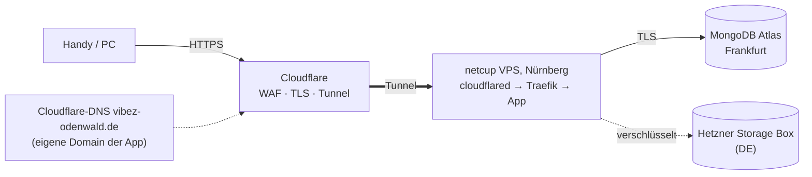

# VIBEZ Nachweise – Betrieb

Betrieb, Infrastruktur und Datenschutzunterlagen für den **Echtbetrieb** von
[VIBEZ Nachweise](https://github.com/mbay-ODW/vibez-nachweise) bei der VIBEZ Kinder- & Jugendhilfe GmbH.

| | |
|---|---|
| **Adresse (geplant)** | `https://nachweise.vibez-odenwald.de` |
| **Stand** | Entwurf 15.11.2026 – Echtbetrieb noch nicht aufgebaut |
| **Demo** | `https://vibez.bay-ram.de` (erfundene Daten, anderer Server, nicht Teil dieses Repos) |



## Dokumente

| Dokument | Inhalt |
|---|---|
| [Betriebsarchitektur](docs/architektur.md) | Entscheidungen, Komponenten, Netze, Domain und DNS, Atlas, Backup, Kosten |
| [Aufbau](docs/aufbau.md) | Aufbauphase mit Claude Code: Regeln, Serverwahl, Remote Control, Tokens, Protokoll, Übergabe |
| [Deployment](docs/deployment.md) | Schritt für Schritt vom leeren Konto bis zur Abnahme |
| [Cloudflare](docs/cloudflare.md) | Konto, Domain `vibez-odenwald.de` und Zone, Tunnel, WAF-Regeln, Einstellungen |
| [Betriebshandbuch](docs/betriebshandbuch.md) | Update, Rollback, Wartung, Wiederherstellung, Störungen, Datenpannen, Übergabe |
| [Sicherheitsanalyse](docs/sicherheitsanalyse.md) | Angriffsvektoren, Befunde, Maßnahmen nach Priorität |
| [Datenschutz-Folgenabschätzung](datenschutz/dsfa.md) | Art. 35 DSGVO – Entwurf zur Prüfung und Freigabe |
| [TOM](datenschutz/tom.md) | Technische und organisatorische Maßnahmen |
| [Verzeichnis-Eintrag](datenschutz/vvt.md) | Art. 30 DSGVO |
| [Dienstleister](datenschutz/dienstleister.md) | Auftragsverarbeiter, Verträge, § 203 StGB |
| [Informationsblätter](datenschutz/informationen.md) | Entwürfe für Familien und Mitarbeitende |

## Struktur

```
stack/                 Docker Compose für den Server
  compose.yml          cloudflared, Traefik, App (feste Version), Netze
  .env.example         Vorlage für Geheimnisse und Versionen (echte .env nur auf dem Server)
  deploy.sh            Version setzen, Backup, ausrollen, Health-Check
  traefik/             statische und dynamische Konfiguration
  cloudflared/         Tunnel-Konfiguration (Zugangsdaten nur auf dem Server)
host/                  Einrichtung und Pflege des Servers
  bootstrap.sh         Härtung Debian, Docker, Tailscale, Firewall
  backup.sh            mongodump aus Atlas -> restic -> Storage Box
  restore.sh           Stände anzeigen, Restore-Test, Wiederherstellung
  atlas-zugriffsliste.sh  Atlas-IP-Zugriffsliste per API auf die Server-IP setzen
  systemd/             Timer für Backup und monatlichen Restore-Test
  logrotate-vibez      14 Tage Zugriffsprotokoll
docs/                  Betrieb
datenschutz/           DSFA, TOM, VVT, Dienstleister, Informationsblätter
```

## Grundsätze

- Alle Konten (netcup, Hetzner Storage Box, Atlas, Cloudflare, Domain) gehören **VIBEZ**; die IT-Betreuung arbeitet als Auftragsverarbeiter.
- Der Server hat **keine offenen Ports**; die Datenbank akzeptiert nur diesen Server.
- **Keine Geheimnisse und keine Personendaten** in diesem Repository.
- **Kein KI- oder Automationszugriff** auf den Echtbetrieb.
