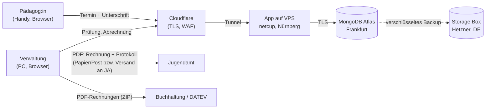

# Datenschutz-Folgenabschätzung (Art. 35 DSGVO) – VIBEZ Nachweise

| | |
|---|---|
| **Verantwortliche** | VIBEZ Kinder- & Jugendhilfe GmbH, Lustgartenstraße 2, 64711 Erbach (Geschäftsführung: Tobias Naas, Moritz Flick) |
| **Verarbeitung** | Digitale Tätigkeitsnachweise, Prüfung und Abrechnung ambulanter Hilfen zur Erziehung („VIBEZ Nachweise“) |
| **Version / Stand** | 0.19 – **Entwurf** vom 18.11.2026 (Testumgebung auf demselben Server mit eigener Datenbank und erfundenen Daten; automatisches Ausrollen neuer Versionen; Anmeldung der App über Authelia/LDAP ab 0.3.x; Verwaltungsoberflächen wie bei DRK: LLDAP, Authelia mit 2FA, Portainer, Dozzle, Uptime Kuma – nur Gruppe `vibez-infra_admin`; SSH ohne Tailscale auf Port 5022; Atlas Flex mit 7 Tagen Snapshots; Installation mit KI ausdrücklich erlaubt, solange keine echten Daten; Cloudflare-Konfiguration als begrenzte Ausnahme in T12; eigene Domain `vibez-odenwald.de` für die App, DNS bei Cloudflare; Server bei netcup über Murat als Unterauftragsverarbeiter, App 0.2.6 mit Zwei-Faktor-Anmeldung, Aufbauphase geregelt) |
| **Erstellt von** | IT-Dienstleister (Murat Bayram) mit technischer Unterstützung; fachliche Angaben von VIBEZ zu bestätigen |
| **Zu prüfen durch** | Datenschutzbeauftragte:r von VIBEZ (siehe Abschnitt 2.3) |
| **Freigabe** | Geschäftsführung VIBEZ (Abschnitt 9) |
| **Wiedervorlage** | jährlich und bei jeder wesentlichen Änderung (neuer Dienstleister, neue Datenkategorie, neue Funktion) |

> Dieses Dokument ist eine fachlich-technische Vorlage. Die rechtliche Bewertung (Abschnitt 4) ist durch die/den
> Datenschutzbeauftragte:n bzw. rechtlich zu bestätigen. Mit **[VIBEZ]** markierte Stellen müssen von VIBEZ ergänzt werden.

## Inhalt

1. [Ergebnis in Kürze](#1-ergebnis-in-kürze)
2. [Notwendigkeit der DSFA und Beteiligte](#2-notwendigkeit-der-dsfa-und-beteiligte)
3. [Systematische Beschreibung der Verarbeitung](#3-systematische-beschreibung-der-verarbeitung)
4. [Rechtsgrundlagen, Notwendigkeit und Verhältnismäßigkeit](#4-rechtsgrundlagen-notwendigkeit-und-verhältnismäßigkeit)
5. [Methode der Risikobewertung](#5-methode-der-risikobewertung)
6. [Risiken und Maßnahmen](#6-risiken-und-maßnahmen)
7. [Maßnahmenplan vor dem Echtbetrieb](#7-maßnahmenplan-vor-dem-echtbetrieb)
8. [Restrisiko und Ergebnis](#8-restrisiko-und-ergebnis)
9. [Stellungnahme und Freigabe](#9-stellungnahme-und-freigabe)
10. [Anhang: Datenfelder](#10-anhang-datenfelder)

---

## 1. Ergebnis in Kürze

- Die Verarbeitung betrifft **Sozialdaten von Kindern, Jugendlichen und Familien** in Hilfesituationen, teils mit
  Gesundheitsbezug. Eine DSFA ist **erforderlich** (Abschnitt 2.1).
- Die App erfasst nur die Daten, die für Tätigkeitsnachweis und Abrechnung nötig sind. Klientenakte, Berichte,
  Dokumente, Adressen und Geburtsdaten wurden bewusst entfernt (Datenminimierung, Abschnitt 4.3).
- Betrieb auf einem eigenen, nur für VIBEZ genutzten Server in Deutschland (netcup, Nürnberg), Datenbank **MongoDB Atlas in Frankfurt**, Schutz durch
  **Cloudflare** (WAF, Tunnel). Der Server hat keine offenen Ports, die Datenbank nimmt nur Verbindungen dieses Servers an.
- Die wesentlichen Risiken sind **Kontoübernahme** (R1), **verlorene Handys** (R2), **zu breite Einsicht über die
  Vertretung** (R3) und der **Drittlandbezug von Cloudflare und MongoDB** (R5, R6).
- Mit den umgesetzten Maßnahmen und den **sieben Maßnahmen vor dem Echtbetrieb** (Abschnitt 7: u. a.
  Zwei-Faktor-Anmeldung, Protokollierung der Vertretungsansicht, Löschkonzept, AV-Verträge) wird das Restrisiko als
  **gering bis mittel** bewertet. Eine vorherige Konsultation der Aufsichtsbehörde (Art. 36 DSGVO) ist dann **nicht
  erforderlich**.
- **Voraussetzung für den Echtbetrieb:** Maßnahmen aus Abschnitt 7 umgesetzt, Freigabe in Abschnitt 9 unterschrieben.

## 2. Notwendigkeit der DSFA und Beteiligte

### 2.1 Warum eine DSFA?

Nach Art. 35 Abs. 1 DSGVO ist eine DSFA durchzuführen, wenn eine Verarbeitung voraussichtlich ein hohes Risiko für die
Rechte und Freiheiten natürlicher Personen zur Folge hat. Nach den Leitlinien der Artikel-29-Gruppe (WP 248 rev.01) ist
das in der Regel der Fall, wenn **zwei oder mehr** Kriterien erfüllt sind. Hier sind es mindestens drei:

| Kriterium (WP 248) | erfüllt | Begründung |
|---|---|---|
| Vertrauliche oder höchstpersönliche Daten | ja | Sozialdaten aus der Kinder- und Jugendhilfe; Hilfeart „Eingliederungshilfe § 35a SGB VIII“ lässt auf eine (drohende) seelische Behinderung schließen (Gesundheitsdatum, Art. 9 DSGVO); Termintexte können Krisen, Konflikte oder Kinderschutzthemen enthalten |
| Daten schutzbedürftiger Betroffener | ja | Kinder, Jugendliche und Familien in belasteten Lebenslagen; zudem Beschäftigte |
| Systematische Überwachung | eher nein | Zeiterfassung der Pädagog:innen je Termin ist Teil der Leistungsdokumentation, keine Verhaltensüberwachung |
| Innovative Technologie / neue organisatorische Lösung | ja | Unterschrift der Klient:innen auf dem Display von Mobilgeräten; Cloud-Dienste (Atlas, Cloudflare) |
| Umfangreiche Verarbeitung | teilweise | rund 115 laufende Hilfen (Rechnungsvolumen), alle Kontakte eines Monats |

### 2.2 Abgrenzung

Gegenstand ist der **Echtbetrieb** nach [Betriebsarchitektur](../docs/architektur.md). Nicht Gegenstand:

- die **Demo** unter `vibez.bay-ram.de`. Sie enthält ausschließlich **erfundene** Daten. Organisatorische Regel: In die Demo
  werden keine echten Daten eingegeben.
- die **Entwicklung** der Software. Sie erfolgt ausschließlich mit erfundenen Daten. KI-Werkzeuge, die bei der Entwicklung
  helfen, haben **keinen Zugriff** auf den Echtbetrieb (Maßnahme T12). Einzige dauerhafte Ausnahme ist die
  Konfiguration der Cloudflare-Zone (siehe T12).
- die übrigen IT-Systeme von VIBEZ (Website und E-Mail bei All-Inkl, Buchhaltung/DATEV). Die App übergibt Rechnungs-PDFs
  per Download an die Buchhaltung; die weitere Verarbeitung dort ist Teil der bestehenden Verfahren.

### 2.3 Beteiligte

| Rolle | Wer | Aufgabe |
|---|---|---|
| Verantwortliche | VIBEZ Kinder- & Jugendhilfe GmbH | Entscheidung über Zwecke und Mittel, Freigabe |
| Datenschutzbeauftragte:r | **[VIBEZ: Name eintragen]** | Beratung und Stellungnahme (Art. 35 Abs. 2 DSGVO). Hinweis: Weil diese Verarbeitung einer DSFA unterliegt, ist nach **§ 38 Abs. 1 Satz 2 BDSG unabhängig von der Mitarbeiterzahl** ein:e Datenschutzbeauftragte:r zu benennen. |
| IT-Dienstleister / Betrieb | Murat Bayram (Auftragsverarbeiter) | Technische Beschreibung, Umsetzung technischer Maßnahmen |
| Fachbereich | Geschäftsführung, Verwaltung (Prüfung/Abrechnung), Pädagog:innen | Fachliche Anforderungen, organisatorische Maßnahmen |
| Betroffene / Vertretungen | – | Die Sicht der Betroffenen wird über die Informationspflichten und Rückmeldungen der Pädagog:innen einbezogen (Art. 35 Abs. 9 DSGVO); eine formale Befragung ist für eine Abrechnungsanwendung unverhältnismäßig. |

## 3. Systematische Beschreibung der Verarbeitung

### 3.1 Zweck

1. **Leistungsnachweis**: Dokumentation der erbrachten Fachleistungsstunden je Klient:in und Monat (Datum, Uhrzeit,
   Tätigkeit, Ort, Anwesende), bestätigt durch die Unterschrift der Klient:in bzw. Sorgeberechtigten.
2. **Prüfung** durch die Verwaltung auf Vollständigkeit und Deckung durch die Bewilligung des Jugendamts.
3. **Abrechnung** gegenüber dem Jugendamt: Rechnung und Tätigkeitsprotokoll im Format des jeweiligen Jugendamts.
4. **Steuerung**: Auslastung, bewilligte und geleistete Stunden, auslaufende Bewilligungen (Betriebsübersicht der Verwaltung).

Keine anderen Zwecke, insbesondere keine Leistungs- oder Verhaltenskontrolle der Beschäftigten über das für Nachweis und
Abrechnung Nötige hinaus. **[VIBEZ: bestätigen; ggf. Betriebsrat/Mitarbeitende informieren]**

### 3.2 Betroffene und Umfang

| Gruppe | Umfang (Schätzung) |
|---|---|
| Klient:innen (Kinder, Jugendliche, junge Volljährige) | ca. 115 laufende Hilfen |
| Familienangehörige/Sorgeberechtigte (Unterschrift, „Anwesende“) | mehrere je Hilfe |
| Fachkräfte der Jugendämter (Name „Fallzuständig im ASD“, „WiJu“) | wenige Dutzend |
| Beschäftigte von VIBEZ (Pädagog:innen, Verwaltung) | **[VIBEZ: Anzahl]** |

### 3.3 Datenkategorien

Vollständige Feldliste im [Anhang](#10-anhang-datenfelder).

| Kategorie | Beispiele | Sensibilität |
|---|---|---|
| Identifikation Klient:in | Vor-/Nachname, Aktenzeichen des Jugendamts, Wohnort (optional) | hoch (Sozialdatum) |
| Hilfe und Bewilligung | Hilfeart (z. B. § 31, § 35a SGB VIII), Jugendamt, Zeitraum, Stundenumfang, Beginn/Ende | hoch; bei § 35a Gesundheitsbezug (Art. 9) |
| Termine | Datum, Uhrzeit, Dauer, **Freitext** zur Tätigkeit, Ort, Anwesende, Besonderheiten | sehr hoch (Freitext kann Krisen, Gesundheit, Kinderschutz enthalten) |
| Unterschriften | Bild der Unterschrift der Klient:in / Sorgeberechtigten je Termin oder Monat, Vermerk „verweigert“ | hoch (Authentizität) |
| Jugendamt-Fachkräfte | Namen | gering |
| Beschäftigte | Name, Benutzername, Rolle, Passwort-Hash, hinterlegte Unterschrift, Zuordnung zu Klient:innen, erbrachte Stunden | mittel (Beschäftigtendaten) |
| Abrechnung | Rechnungsnummer, Beträge, Stundensatz, Rechnungsempfänger | mittel |
| Protokolle | Änderungsprotokoll (wer hat wann was geändert, alte/neue Werte), Zugriffsprotokoll Traefik (IP, Land, Zeit, Pfad; 14 Tage) | mittel |

Bewusst **nicht** erfasst: Geburtsdatum, Anschrift, Telefon, Sorgeberechtigte als Datensatz, Diagnosen, Berichte,
Hilfeplan-Inhalte, Dokumente/Uploads, Fotos, Standortdaten.

### 3.4 Ablauf und Datenflüsse

1. Die Pädagog:in meldet sich im Browser an und erfasst je Termin Datum, Uhrzeit, Tätigkeit, Ort und Anwesende. Die
   Klient:in bzw. sorgeberechtigte Person unterschreibt auf dem Display (oder verweigert, das wird vermerkt).
2. Am Monatsende schickt die Pädagog:in den Nachweis an die Verwaltung (nur wenn vollständig und durch die Bewilligung
   gedeckt).
3. Die Verwaltung prüft, korrigiert bei Bedarf (protokolliert) und erzeugt die Rechnung.
4. Rechnung und Tätigkeitsprotokoll werden als PDF gedruckt und wie bisher an das Jugendamt übermittelt. Die Rechnungs-PDFs
   gehen zusätzlich als ZIP an die Buchhaltung.

### 3.5 Empfänger

| Empfänger | Was | Grundlage |
|---|---|---|
| Zuständiges Jugendamt (Odenwaldkreis, Kreis Bergstraße) | Rechnung + Tätigkeitsprotokoll des Monats | Leistungs-/Entgeltvereinbarung, Abrechnung |
| Steuerberatung / DATEV | Rechnungen (ohne Termininhalte) | Buchführungspflicht |
| Auftragsverarbeiter (Abschnitt 3.6) | technisch bedingt | Art. 28 DSGVO |

Keine Übermittlung an sonstige Dritte, keine Werbung, kein Tracking.

### 3.6 Technik und Dienstleister

Details: [Betriebsarchitektur](../docs/architektur.md), [Dienstleister](dienstleister.md).

| Dienstleister | Rolle | Sitz / Ort der Verarbeitung | Zugriff auf Inhalte |
|---|---|---|---|
| netcup GmbH, Karlsruhe (Unterauftragsverarbeiter von Murat) | Server (VPS) | Deutschland (Rechenzentrum Nürnberg) | technisch möglich (Betreiber der Hardware) |
| Hetzner Online GmbH | Speicher für die zweite Sicherung (Storage Box) | Deutschland | nein – Daten sind vor der Übertragung verschlüsselt |
| MongoDB, Inc. (mit AWS als Unterauftragnehmer) | Datenbank (Atlas) | USA / Speicherort AWS Frankfurt | gespeichert verschlüsselt; Betreiberzugriff technisch möglich, vertraglich ausgeschlossen |
| Cloudflare, Inc. | DNS der App-Domain `vibez-odenwald.de`; Schutzschicht für die App (TLS-Terminierung, WAF, Tunnel) | USA / Verarbeitung im nächstgelegenen Rechenzentrum | Inhalte kurzzeitig im Arbeitsspeicher beim Weiterleiten; keine Speicherung von Seiteninhalten |
| Murat Bayram | IT-Betreuung (Einrichtung, Updates, Backup, Störungen) | Deutschland | Administrativer Zugang; Datenbankzugriff nur bei Wartung, protokolliert |
| febas (Registrar von `vibez-odenwald.de`) | Registrierung der App-Domain | Deutschland/EU | keine Klientendaten (nur Domaindaten) |
| GitHub, Inc. | Quellcode und Container-Image | USA | keine Klientendaten |

### 3.7 Speicherdauer

| Daten | Vorschlag | Grundlage |
|---|---|---|
| Rechnungen inkl. beigefügter Tätigkeitsprotokolle | 8 Jahre ab Ende des Kalenderjahres | § 147 AO / § 14b UStG in der seit 2025 geltenden Fassung **[mit Steuerberatung bestätigen]** |
| Tätigkeitsnachweise (Termine, Unterschriften) | wie Rechnungen, sofern Beleg; sonst nach Vorgabe der Leistungsvereinbarungen **[VIBEZ: Vorgaben der Jugendämter prüfen]** | Nachweispflicht gegenüber dem Kostenträger |
| Stammdaten Klient:in | bis zum Ablauf der Fristen der zugehörigen Nachweise | Erforderlichkeit |
| Benutzerkonten Beschäftigte | deaktivieren bei Austritt; löschen nach Ablauf der Fristen der von ihnen erfassten Nachweise | Erforderlichkeit |
| Änderungsprotokoll | wie die zugehörigen Nachweise; Anmeldeereignisse 12 Monate | Nachvollziehbarkeit |
| Zugriffsprotokoll Traefik | 14 Tage | Sicherheit |
| Backups | Atlas und restic: bis 12 Monate. Gelöschte Daten verschwinden spätestens nach 12 Monaten auch aus den Backups. | Verfügbarkeit |

Eine **Löschfunktion** fehlt in der App derzeit (Maßnahme M5).

## 4. Rechtsgrundlagen, Notwendigkeit und Verhältnismäßigkeit

### 4.1 Rechtsgrundlagen (vorläufige Einschätzung, durch DSB zu bestätigen)

| Verarbeitung | Rechtsgrundlage |
|---|---|
| Nachweis der Leistungen gegenüber Leistungsberechtigten und Kostenträger | Art. 6 Abs. 1 lit. b DSGVO (Durchführung des Betreuungsverhältnisses) i. V. m. den Leistungs- und Entgeltvereinbarungen (§§ 77, 78a ff. SGB VIII) |
| Abrechnung, Aufbewahrung der Rechnungen | Art. 6 Abs. 1 lit. b und lit. c DSGVO i. V. m. § 147 AO, § 257 HGB, § 14b UStG |
| Gesundheitsbezogene Angaben (z. B. § 35a SGB VIII, Freitexte) | Art. 9 Abs. 2 lit. h DSGVO i. V. m. § 22 Abs. 1 Nr. 1 lit. b BDSG. Die Verarbeitung erfolgt durch Fachkräfte, die der Schweigepflicht nach § 203 StGB unterliegen. Die nach § 22 Abs. 2 BDSG nötigen angemessenen Maßnahmen sind in Abschnitt 6 und in den [TOM](tom.md) beschrieben. |
| Daten der Beschäftigten | Art. 6 Abs. 1 lit. b DSGVO (Arbeitsvertrag), Art. 88 DSGVO i. V. m. § 26 BDSG, soweit anwendbar |
| Sozialdatenschutz | VIBEZ ist freier Träger. Die Jugendämter müssen nach **§ 61 Abs. 3 SGB VIII** sicherstellen, dass der Schutz der Sozialdaten beim Träger **in entsprechender Weise** gewährleistet ist. Die Maßstäbe des § 35 SGB I und der §§ 67 ff. SGB X werden deshalb sinngemäß angelegt, auch zur Auftragsverarbeitung (§ 80 SGB X): Gespeichert wird nur in Deutschland. Für den Zugriff von Cloudflare und MongoDB aus den USA besteht ein Angemessenheitsbeschluss (EU-US Data Privacy Framework), zusätzlich gelten Standardvertragsklauseln. |
| Unterschrift auf dem Display | Bestandteil des Nachweises (Art. 6 Abs. 1 lit. b). Keine biometrische Auswertung: Gespeichert wird nur ein Bild, keine Druck- oder Zeitverläufe, also keine biometrischen Daten im Sinne von Art. 4 Nr. 14 DSGVO. |

**[VIBEZ]** Die Datenschutzklauseln in den Leistungsvereinbarungen mit dem Odenwaldkreis und dem Kreis Bergstraße prüfen
(z. B. Vorgaben zu Cloud-Diensten, Informationspflichten gegenüber dem Jugendamt). Die Akzeptanz digital unterschriebener
und ausgedruckter Tätigkeitsprotokolle durch die Jugendämter klären.

### 4.2 Notwendigkeit

Ohne die Verarbeitung kann VIBEZ die Leistungen nicht nachweisen und nicht abrechnen. Die digitale Erfassung ersetzt
Papierprotokolle. Diese gingen bisher durch mehrere Hände, mussten abgetippt und kopiert werden und waren nicht gegen
Verlust geschützt. Die App reduziert Medienbrüche und Fehler, etwa Stunden über der Bewilligung oder fehlende Unterschriften.

### 4.3 Datenminimierung und Verhältnismäßigkeit

- Mit Version 0.2 wurden auf Wunsch von VIBEZ entfernt: Klientenakte (Verlauf, Berichte, Dokumente/Uploads), Geburtsdatum,
  Telefon, Adresse, Sorgeberechtigte, Hilfeplantermine und Notizen. Wohnort, WiJu-Fachkraft und letzter Hilfeplan sind
  **optional** und nur für das Formular des Kreises Bergstraße vorgesehen.
- Termintexte sind Freitext, weil das Formular des Jugendamts eine Beschreibung der Tätigkeit verlangt. Textbausteine
  lenken auf kurze, sachliche Angaben. Schulung: keine Diagnosen oder unnötigen Details (Maßnahme O3).
- Pädagog:innen sehen standardmäßig nur ihre eigenen Klient:innen. Eine Gesamtliste haben nur die Verwaltungsrollen.
- Keine Tracking-, Analyse- oder Werbedienste. Die Schrift wird lokal ausgeliefert (keine Google Fonts), es werden keine
  Inhalte von Drittanbietern geladen (Content-Security-Policy).
- Die Steuerungsübersicht zeigt aggregierte Kennzahlen und dient nicht zur Bewertung einzelner Beschäftigter.

### 4.4 Rechte der Betroffenen

| Recht | Umsetzung |
|---|---|
| Information (Art. 13/14) | Informationsblatt für Familien und für Beschäftigte ([informationen.md](informationen.md)), Ausgabe bei Hilfebeginn bzw. Einstellung |
| Auskunft (Art. 15) | Die Verwaltung erzeugt die Tätigkeitsprotokolle (PDF) aller Monate einer Klient:in. Ein Gesamtexport je Person ist geplant (M7). |
| Berichtigung (Art. 16) | Korrektur in der App bis zur Abrechnung; danach Storno und Neuerstellung, protokolliert |
| Löschung / Einschränkung (Art. 17/18) | nach Löschkonzept (M5); Aufbewahrungspflichten haben Vorrang |
| Widerspruch (Art. 21) | nicht einschlägig (keine Verarbeitung auf Grundlage von lit. e/f für Kernzwecke) |
| Unterschrift verweigern | jederzeit möglich, wird vermerkt; die hilfesteuernde Fachkraft wird informiert (Vorgabe des Jugendamts) |

## 5. Methode der Risikobewertung

Bewertung nach dem Vorgehen der Datenschutzkonferenz (Kurzpapier Nr. 18 „Risiko für die Rechte und Freiheiten“) und den
Gewährleistungszielen des Standard-Datenschutzmodells (SDM): Datenminimierung, Verfügbarkeit, Integrität, Vertraulichkeit,
Nichtverkettung, Transparenz, Intervenierbarkeit.

- **Schwere** des möglichen Schadens: geringfügig · überschaubar · substanziell · groß
- **Eintrittswahrscheinlichkeit**: geringfügig · überschaubar · substanziell · hoch
- **Risiko** aus beiden: gering · mittel · hoch

Wegen der Art der Daten (Kinder- und Jugendhilfe) wird die **Schwere einer Offenlegung grundsätzlich als „groß“** angesetzt:
mögliche Stigmatisierung, Gefährdung von Hilfebeziehungen, im Kinderschutz auch Gefährdung von Personen.

Risikoquellen: externe Angreifer, unbefugte Beschäftigte, Dienstleister und deren Beschäftigte, staatliche Stellen in
Drittländern, Bedienfehler, technische Störungen.

## 6. Risiken und Maßnahmen

Status der Maßnahmen: ✅ umgesetzt · ⏳ vor dem Echtbetrieb umzusetzen (Abschnitt 7) · ➕ empfohlen.

### R1 – Unbefugter Zugriff durch Übernahme eines Benutzerkontos
*Vertraulichkeit · Schwere: groß · Wahrscheinlichkeit ohne Maßnahmen: substanziell → Risiko hoch*

Gestohlene, erratene oder wiederverwendete Passwörter, Phishing.

- ✅ Eigene Konten für jede Person, keine Sammelkonten; Rollen Pädagog:in / Verwaltung
- ✅ Passwörter nur als scrypt-Hash
- ✅ Anmeldebremse dreifach: App (10 Fehlversuche je Konto, 30 je IP in 10 Minuten; IP von Cloudflare, nicht vom Client fälschbar), Cloudflare (5 Anmeldeversuche je IP in 10 s), Traefik (Rate je IP); fehlgeschlagene Anmeldungen protokolliert
- ✅ Zugriff nur aus der EU und der Schweiz (Cloudflare-Geo-Block); bekannte Bots und Scanner blockiert
- ✅ Sitzungs-Cookie `HttpOnly`, `Secure`, `SameSite=Lax`, signiert; CSRF-Schutz bei allen Formularen
- ✅ Deaktivierte Konten verlieren sofort jede Sitzung; Passwortwechsel/-reset beendet alle Sitzungen; „auf allen Geräten abmelden“
- ✅ **M1 Zwei-Faktor-Anmeldung (TOTP)**, Pflicht für die Verwaltungsrolle, freiwillig für Pädagog:innen (seit 0.2.6)
- ✅ **M2 Passwortregeln**: Mindestlänge 12, Sperrliste häufiger Passwörter, nicht der eigene Name (seit 0.2.5); Wechsel des Startpassworts erzwungen (seit 0.2.6)
- ✅ Organisatorisch: Startpasswörter persönlich übergeben (Betriebshandbuch)

*Restrisiko: gering (mit M1/M2)*

### R2 – Verlust oder Diebstahl eines Mobilgeräts mit aktiver Sitzung
*Vertraulichkeit · Schwere: groß · Wahrscheinlichkeit: überschaubar → Risiko mittel*

- ✅ Keine Daten auf dem Gerät gespeichert: keine App-Installation mit Datenhaltung, `Cache-Control: no-store`
- ✅ Sitzung läuft nach spätestens 12 Stunden ab; sofortige Sperre durch Deaktivieren des Kontos
- ✅ **M3 Inaktivitäts-Abmeldung** nach 2 Stunden (seit 0.2.5)
- ⏳ **O1 Geräteregeln** für Pädagog:innen: Bildschirmsperre mit PIN/Biometrie, aktuelles Betriebssystem, keine gemeinsam genutzten Geräte ohne Abmelden, Verlust **sofort** der Verwaltung melden

*Restrisiko: gering*

### R3 – Einsicht in Daten über das Erforderliche hinaus (Need-to-know)
*Vertraulichkeit, Nichtverkettung · Schwere: substanziell · Wahrscheinlichkeit: überschaubar → Risiko mittel*

Für Vertretungen können Pädagog:innen die Klient:innen jeder Kollegin und jedes Kollegen öffnen.

- ✅ Standardansicht nur eigene Klient:innen; Vertretung muss bewusst gewählt werden und wird deutlich angezeigt
- ✅ Alle Änderungen protokolliert (wer, wann, was, alte/neue Werte)
- ✅ **M4 Protokollierung der Vertretungsansicht** (auch reines Lesen fremder Klient:innen, seit 0.2.5); ⏳ monatliche Stichprobe durch die Verwaltung
- ➕ Alternativ/zusätzlich: Vertretung nur nach Freigabe durch die Verwaltung bzw. befristet
- ✅ Organisatorisch: Verpflichtung auf Vertraulichkeit / Sozialgeheimnis und § 203 StGB (bestehend bei VIBEZ **[VIBEZ: bestätigen]**)

*Restrisiko: gering*

### R4 – Angriffe auf die Anwendung (Web-Schwachstellen)
*Vertraulichkeit, Integrität · Schwere: groß · Wahrscheinlichkeit: überschaubar → Risiko mittel*

- ✅ Serverseitig gerenderte Seiten mit automatischem Maskieren aller Ausgaben (XSS-Schutz)
- ✅ Content-Security-Policy ohne Inline-Skripte, keine Fremdquellen, kein Einbetten (Clickjacking)
- ✅ Datenbankzugriffe ausschließlich über parametrisierte Abfragen (PyMongo), keine Datei-Uploads
- ✅ Rechteprüfung serverseitig in jeder Route; automatisierte Tests in der CI (u. a. Zugriffsschutz)
- ✅ Cloudflare-WAF (Managed Ruleset, Scanner-Pfade, Methoden), keine öffentliche Admin- oder API-Oberfläche
- ➕ Externer Sicherheitstest (Pentest) vor oder kurz nach dem Echtbetrieb

*Restrisiko: gering*

### R5 – Kenntnisnahme durch Cloudflare oder staatliche Stellen in den USA (Datenverkehr)
*Vertraulichkeit · Schwere: groß · Wahrscheinlichkeit: geringfügig → Risiko mittel*

Cloudflare entschlüsselt den Datenverkehr am Rand seines Netzes, um ihn prüfen zu können. Im Free-Tarif ist die
Verarbeitung nicht auf EU-Rechenzentren beschränkt.

- ✅ Vertrag: Cloudflare-DPA mit Standardvertragsklauseln; Cloudflare ist nach eigenen Angaben unter dem EU-US Data Privacy Framework zertifiziert **[vor Vertragsschluss in der DPF-Liste prüfen]**
- ✅ Keine Speicherung von Seiteninhalten: Cache-Regel „Bypass“ für alle Seiten, zusätzlich `Cache-Control: no-store` aus der App
- ✅ Keine eingefügten Skripte (Rocket Loader, Mail-Verschleierung, Web Analytics aus)
- ✅ Nutzer:innen in Hessen werden in der Praxis über deutsche Rechenzentren bedient
- Abwägung: Ohne Cloudflare wäre der Server direkt aus dem Internet erreichbar (höheres Risiko bei R4 und R7). Der Schutzgewinn wird höher bewertet als das zusätzliche Offenlegungsrisiko.
- ➕ Bei Bedarf: Cloudflare Enterprise mit Regional Services (TLS nur in der EU) oder Verzicht auf den Proxy (DNS-only + Schutz auf dem Server)

*Restrisiko: gering bis mittel – von der Geschäftsführung bewusst zu akzeptieren (Abschnitt 9)*

### R6 – Kenntnisnahme durch MongoDB/AWS oder staatliche Stellen in den USA (gespeicherte Daten)
*Vertraulichkeit · Schwere: groß · Wahrscheinlichkeit: geringfügig → Risiko mittel*

- ✅ Speicherort ausschließlich AWS Frankfurt (eu-central-1); Backups in derselben Region
- ✅ Verschlüsselung ruhender Daten (Atlas-Standard) und TLS für alle Verbindungen
- ✅ Netzwerkzugang nur von der festen IP des Servers (IP-Zugriffsliste, per API gepflegt); Benutzer je Zweck mit minimalen Rechten
- ⏳ **M6 Verträge**: MongoDB-DPA (inkl. SCC) dokumentieren; DPF-Zertifizierung prüfen
- ➕ Eigener Schlüssel für die Verschlüsselung (Customer Key Management, ab dediziertem Cluster)
- Alternative mit geringerem Drittlandbezug: MongoDB als Container auf dem Server ([Architektur](../docs/architektur.md#atlas-einrichtung-wie-drk)). Bewusst verworfen zugunsten der Atlas-Vorteile (verwaltete Backups, Replikation, Verschlüsselung) und eines einheitlichen Betriebsmodells.

*Restrisiko: gering bis mittel – von der Geschäftsführung bewusst zu akzeptieren*

### R7 – Kompromittierung des Servers
*Vertraulichkeit, Integrität, Verfügbarkeit · Schwere: groß · Wahrscheinlichkeit: überschaubar → Risiko mittel*

- ✅ Kein Web-Port am Server (Cloudflare Tunnel); eingehend nur SSH 5022
- ✅ Verwaltungsoberflächen nur über den Tunnel und Authelia (2FA, Gruppe `vibez-infra_admin`); Cloudflare-WAF: nur EU/CH, keine bekannten Bots, nur bekannte Hostnamen
- ✅ SSH nur per Schlüssel auf Port 5022, kein root- und Passwort-Login, `ufw limit` (Ratenbegrenzung) (Entscheidung 18.11.2026: kein VPN; SSH ist öffentlich erreichbar)
- ✅ Automatische Sicherheitsupdates; Container read-only, ohne Zusatzrechte, feste Versionen; interne Netze ohne Internet für Traefik/App-Frontnetz
- ⏳ **Automatisches Ausrollen** (Entscheidung Murat, 18.11.2026): neue Versionsnummern auf `main` gehen ohne weiteren Schritt live. Ohne Branch-Schutz (im kostenlosen GitHub-Tarif nicht verfügbar) reicht ein übernommenes GitHub-Konto, um Code in den Echtbetrieb zu bringen. Begrenzung: 2FA mit Passkey am GitHub-Konto, Image nur bei grüner CI, Digest-Protokoll, Rücksprung bei Fehler, Prüfung auf der Testumgebung; ➕ GitHub Pro mit Branch-Schutz
- ✅ **Testumgebung** `nachweise-testing` auf demselben Server: eigene Atlas-Datenbank (Testprojekt), nur erfundene Daten, eigene Netze, eigenes Proxy-Geheimnis, eigene LDAP-Gruppen; Zugriff nur über Authelia (2FA)
- ✅ Geheimnisse nur auf dem Server (`.env`, Rechte 600), nicht im Repository
- ✅ Datenbankbenutzer der App darf nur die eigene Datenbank; die Datenbank akzeptiert nur diesen Server

*Restrisiko: gering*

### R8 – Missbrauch durch den IT-Dienstleister (privilegierter Innentäter)
*Vertraulichkeit · Schwere: groß · Wahrscheinlichkeit: geringfügig → Risiko mittel*

- ⏳ **M6 AV-Vertrag VIBEZ ↔ IT-Dienstleister** inkl. Verpflichtung zur Verschwiegenheit nach § 203 Abs. 4 StGB
- ⏳ Atlas und Storage Box gehören VIBEZ (Dienstleister nur als Mitglied mit 2FA). Server (netcup), Cloudflare-Zone und Domain laufen dauerhaft auf dem Dienstleister: Unterauftrag im AV-Vertrag genehmigt, Übertragung bzw. Neuaufbau bei Ende der Betreuung geregelt, Notzugang für VIBEZ zur netcup-Konsole. Die Klientendaten liegen in Atlas unter dem Vertrag von VIBEZ; der Server ist ersetzbar
- ✅ Wartungsprotokoll für jede Wartung mit Datenbankzugriff; Atlas-Aktivitätsprotokoll
- ✅ **Keine KI- oder Automationswerkzeuge mit Zugriff auf den Echtbetrieb** (kein Portainer-MCP o. ä., kein SSH, keine Datenbank); Entwicklung nur mit erfundenen Daten (T12)
- ⏳ **Verwaltungsoberflächen wie bei DRK (Entscheidung Murat, 18.11.2026): LLDAP (Benutzer und Gruppen), Authelia (Anmeldung mit 2FA), Portainer, Dozzle und Uptime Kuma auf dem Server, nur über den Tunnel unter `auth.`, `ldap.`, `portainer.`, `logs.` und `status.vibez-odenwald.de`; Zugang nur für die LDAP-Gruppe `vibez-infra_admin` mit zweitem Faktor.** Portainer kann in jeden Container (auch die App) und damit mittelbar auf alle Daten in Atlas zugreifen; Dozzle zeigt Container-Protokolle, die Personendaten enthalten können. Begrenzung: nur benannte Personen in der Gruppe, Authelia mit TOTP/Passkey, Sperre nach 5 Fehlversuchen, Sitzungsende nach 2 h Inaktivität, Oberflächen nie mit KI-Werkzeugen verbinden; Mitgliedschaft in `vibez-infra_admin` bei jeder monatlichen Wartung prüfen. **Restrisiko von VIBEZ (Geschäftsführung) bewusst zu akzeptieren.**
- ⏳ **Begrenzte Ausnahme Cloudflare (T12):** Die KI-Werkzeuge des Dienstleisters sind über die Cloudflare-Anbindung (MCP) mit seinem Konto verbunden, in dem die Zone `vibez-odenwald.de` liegt. Sie sehen keine Inhalte, könnten aber DNS, WAF oder Tunnel-Routing ändern und den Datenverkehr umleiten. Begrenzung: Änderungen nur mit ausdrücklicher Freigabe des Dienstleisters im Einzelfall und Eintrag im Wartungsprotokoll; Cloudflare-Benachrichtigung bei DNS-Änderungen; Prüfung des Cloudflare-Audit-Logs bei der monatlichen Wartung; Konto mit 2FA (Passkey)
- ✅ **Aufbauphase:** Die Installation mit KI ist ausdrücklich erlaubt (jeder von Murat bereitgestellte Zugang: Claude Code auf dem Server, Remote Control, SSH, API-Tokens), aber nur, solange **keine echten Daten** vorhanden sind; Geheimnisse werden dabei auf dem Server erzeugt und nicht ausgegeben; vor dem ersten echten Datensatz werden Remote Control und Claude Code entfernt und alle dabei genutzten Tokens gelöscht ([Aufbau](../docs/aufbau.md))

*Restrisiko: gering*

### R9 – Datenverlust (Fehlbedienung, Defekt, Ransomware)
*Verfügbarkeit, Integrität · Schwere: substanziell · Wahrscheinlichkeit: überschaubar → Risiko mittel*

- ✅ Atlas Backup (Flex): tägliche Snapshots, 7 Tage (laut Atlas-Oberfläche, Murat 18.11.2026), kein Point-in-Time
- ✅ Zweite, unabhängige Sicherung (längere Aufbewahrung als Atlas Flex): nächtlich, verschlüsselt (restic) auf Hetzner Storage Box, 12 Monate
- ✅ Monatlicher automatischer Wiederherstellungstest; Überwachung der Backups
- ✅ Rechnungen als unveränderlicher Schnappschuss; Storno statt Löschen
- ✅ Wiederherstellungsschlüssel zusätzlich offline bei VIBEZ

*Restrisiko: gering*

### R10 – Nichtverfügbarkeit (Ausfall Cloudflare, netcup, Atlas)
*Verfügbarkeit · Schwere: überschaubar · Wahrscheinlichkeit: überschaubar → Risiko gering*

- ✅ Überwachung mit Alarm; Wiederanlauf eines neuen Servers innerhalb eines Arbeitstags (Daten liegen in Atlas)
- ⏳ Atlas Flex: gemeinsam genutzte Hardware, begrenzter Speicher und Durchsatz (Grenzen laut aktuellem Atlas-Preisblatt); Speicheralarm bei 70 % und Wechsel auf M10 bei Bedarf
- ✅ Fachlich unkritisch: Termine können nachgetragen werden; Papier-Formular als Rückfallebene **[VIBEZ: bereithalten]**

*Restrisiko: gering*

### R11 – Unrichtige Daten, Fehlzuordnung, Fehlversand
*Integrität · Schwere: substanziell · Wahrscheinlichkeit: überschaubar → Risiko mittel*

Falsche Stunden führen zu falschen Rechnungen. Ein Nachweis beim falschen Jugendamt ist eine Datenpanne.

- ✅ Pflichtprüfungen vor dem Abschicken (Unterschrift, Bewilligung, Stundengrenzen je Woche/Monat/Kontingent)
- ✅ Prüfung durch die Verwaltung; Änderung nach der Prüfung setzt den Nachweis zurück
- ✅ Druckstapel je Jugendamt getrennt; Rechnung und Protokoll werden gemeinsam erzeugt (keine Vermischung)
- ✅ Änderungsprotokoll mit alten/neuen Werten

*Restrisiko: gering*

### R12 – Zu lange Speicherung
*Datenminimierung, Intervenierbarkeit · Schwere: überschaubar · Wahrscheinlichkeit: hoch (ohne Löschfunktion) → Risiko mittel*

- ⏳ **M5 Löschkonzept** (Fristen nach 3.7) vor dem Echtbetrieb; **Löschfunktion** in der App (Klient:in nach Fristablauf vollständig löschen, Konten anonymisieren) spätestens vor Ablauf der ersten Frist
- ✅ Kurze Fristen für technische Protokolle (14 Tage) und Backups (12 Monate)

*Restrisiko: gering (mit M5)*

### R13 – Fehlende Transparenz für Betroffene
*Transparenz · Schwere: überschaubar · Wahrscheinlichkeit: substanziell → Risiko mittel*

- ⏳ **O2 Informationsblätter** für Familien (bei Hilfebeginn bzw. vor der ersten digitalen Unterschrift) und für Beschäftigte ([Entwürfe](informationen.md))
- ⏳ **M7 Auskunft**: Export aller Daten zu einer Klient:in (geplant); bis dahin manuell über die PDF-Protokolle

*Restrisiko: gering*

### R14 – Missbrauch gespeicherter Unterschriften
*Integrität · Schwere: substanziell · Wahrscheinlichkeit: geringfügig → Risiko gering*

Die hinterlegte Unterschrift der Pädagog:in wird automatisch auf die Protokolle gedruckt. Unterschriften der Klient:innen
liegen als Bild vor.

- ✅ Unterschriften werden nur in den PDFs des jeweiligen Nachweises verwendet und beim Speichern geprüft (nur PNG, Größenlimit) und neu kodiert
- ✅ Ein bereits gespeichertes Unterschriftsbild wird für einen weiteren Termin abgelehnt und protokolliert (seit 0.2.5)
- ✅ Klient:innen-Unterschrift je Termin bzw. Monat, mit Zeitstempel, nicht übertragbar auf andere Termine
- ✅ Jede Unterschrift und Änderung ist protokolliert

*Restrisiko: gering*

## 7. Maßnahmenplan vor dem Echtbetrieb

| Nr. | Maßnahme | Verantwortlich | Bis |
|---|---|---|---|
| M1 | Zwei-Faktor-Anmeldung (TOTP), Pflicht für Verwaltung ✅ | IT (App) | erledigt (0.2.6) |
| M2 | Passwortregeln ✅; Wechsel des Startpassworts erzwingen ✅ | IT (App) | erledigt (0.2.6) |
| M3 | Abmeldung bei Inaktivität (2 h) ✅ | IT (App) | erledigt (0.2.5) |
| M4 | Protokollierung der Vertretungsansicht ✅ + monatliche Stichprobe ⏳ | IT (App) / Verwaltung | vor Echtbetrieb |
| S1 | Maßnahmen aus der [Sicherheitsanalyse](../docs/sicherheitsanalyse.md#nächste-schritte-nach-priorität) (2FA aller Konten, Domain-Absicherung, Snapshots, Tailscale-ACL) | IT / VIBEZ | vor Echtbetrieb |
| M5 | Löschkonzept beschlossen; Löschfunktion in der App | VIBEZ / IT | Konzept vor Echtbetrieb, Funktion vor Ablauf der ersten Frist |
| M6 | AV-Verträge: IT-Dienstleister (inkl. § 203 StGB, mit Genehmigung der Unterauftragsverarbeiter netcup und Cloudflare), Hetzner (Storage Box), MongoDB; Murat ↔ netcup und Murat ↔ Cloudflare; DPF-Status prüfen | VIBEZ / Murat | vor Echtbetrieb |
| M7 | Auskunftsexport je Klient:in | IT (App) | innerhalb von 6 Monaten |
| O1 | Geräteregeln für Pädagog:innen, Einweisung | VIBEZ | vor Echtbetrieb |
| O2 | Informationsblätter ausgeben | VIBEZ | vor Echtbetrieb |
| O3 | Schulung: sachliche, knappe Termintexte; keine Diagnosen | VIBEZ | vor Echtbetrieb |
| O4 | Datenschutzbeauftragte:n benennen und der Aufsichtsbehörde melden (§ 38 BDSG, Art. 37 Abs. 7 DSGVO) | VIBEZ | vor Echtbetrieb |
| O5 | Verzeichnis der Verarbeitungstätigkeiten ergänzen ([vvt.md](vvt.md)) | VIBEZ | vor Echtbetrieb |
| O6 | Leistungsvereinbarungen auf Datenschutzvorgaben prüfen; Jugendämter informieren | VIBEZ | vor Echtbetrieb |
| T12 | Kein KI-/Automationszugriff auf den Echtbetrieb; Prüfpunkt in der Abnahme. Verwaltungsoberflächen (Portainer, Dozzle, LLDAP, Uptime Kuma) nur für Menschen in `vibez-infra_admin` mit 2FA, nie an KI-Werkzeuge (z. B. Portainer-MCP) angebunden. **Ausnahme:** Konfiguration der Cloudflare-Zone über Murats Cloudflare-Anbindung (MCP) – nur Einstellungen, keine Inhalte; Änderungen nur mit Freigabe im Einzelfall, Wartungsprotokoll, DNS-Änderungs-Benachrichtigung, monatliche Prüfung des Audit-Logs (Entscheidung 18.11.2026) | IT | dauerhaft |

## 8. Restrisiko und Ergebnis

| Risiko | vorher | nachher (mit Maßnahmen aus Abschnitt 6 und 7) |
|---|---|---|
| R1 Kontoübernahme | hoch | gering |
| R2 Verlorenes Gerät | mittel | gering |
| R3 Need-to-know / Vertretung | mittel | gering |
| R4 Web-Angriffe | mittel | gering |
| R5 Cloudflare / Drittland (Verkehr) | mittel | gering bis mittel |
| R6 MongoDB / Drittland (Speicherung) | mittel | gering bis mittel |
| R7 Server-Kompromittierung | mittel | gering |
| R8 Innentäter IT-Dienstleister | mittel | gering |
| R9 Datenverlust | mittel | gering |
| R10 Nichtverfügbarkeit | gering | gering |
| R11 Unrichtige Daten / Fehlversand | mittel | gering |
| R12 Zu lange Speicherung | mittel | gering |
| R13 Transparenz | mittel | gering |
| R14 Unterschriften | gering | gering |

**Ergebnis:** Nach Umsetzung der Maßnahmen verbleibt **kein hohes Risiko**. Die Restrisiken R5 und R6 (Drittlandbezug von
Cloudflare und MongoDB) sind gering bis mittel. Die Geschäftsführung akzeptiert sie bewusst und begründet. Eine vorherige
Konsultation der Aufsichtsbehörde nach Art. 36 DSGVO ist **nicht erforderlich**.

Sollte die Geschäftsführung R5/R6 nicht akzeptieren, gibt es Alternativen mit geringerem Drittlandbezug:

- Datenbank auf dem eigenen Server statt in Atlas.
- Cloudflare ohne Proxy, also nur DNS, mit Schutz auf dem Server.

Beide Alternativen bringen eigene Nachteile mit sich, siehe [Architektur](../docs/architektur.md).

## 9. Stellungnahme und Freigabe

**Stellungnahme der/des Datenschutzbeauftragten** (Art. 35 Abs. 2 DSGVO):

> **[Text]**

Name, Datum, Unterschrift: ______________________________________________

**Freigabe durch die Verantwortliche:**

- [ ] Die Maßnahmen aus Abschnitt 7 sind umgesetzt bzw. terminiert.
- [ ] Die Restrisiken R5 und R6 werden bewusst akzeptiert (Begründung: Abschnitt 6).
- [ ] Die Wiedervorlage ist terminiert: **[Datum]**.

Erbach, den ______________ Geschäftsführung: ______________________________________________

## 10. Anhang: Datenfelder

| Bereich | Feld | Pflicht | Bemerkung |
|---|---|---|---|
| Klient:in | Vorname, Nachname | ja | |
| | Aktenzeichen Jugendamt | nein | für Rechnung/Protokoll |
| | Hilfeart | ja | z. B. „Erziehungsbeistand (§ 30 SGB VIII)“; steht auf der Rechnung |
| | Jugendamt | ja | Rechnungsempfänger |
| | Fallzuständig im ASD | nein | Freitext (Name der Fachkraft) |
| | Zuständige Pädagog:in | ja | |
| | Beginn / Ende der Hilfe | nein | |
| | Wohnort, WiJu, letzter Hilfeplan | nein | nur für das Formular Kreis Bergstraße |
| Bewilligung | Zeitraum, Art (Woche/Monat/Kontingent), Umfang FLS, Zusatzkontingent | ja | |
| Termin | Datum, von, bis, Stunden | ja | 15-Minuten-Raster |
| | Tätigkeit | ja | Freitext mit Textbausteinen |
| | Ort, Anwesende, Besonderheiten | nein | |
| | Unterschrift Klient:in bzw. „verweigert“ | je nach Jugendamt | Bild (PNG) |
| | erfasst von / geändert von / Zeitpunkte | automatisch | |
| Nachweis | Status, eingereicht/geprüft (wer, wann), Monatsunterschrift | automatisch | |
| Rechnung | Nummer, Datum, Positionen, Beträge, Schnappschuss der Druckfelder, Status/Storno | automatisch | |
| Beschäftigte | Name, Anrede, Benutzername, Rolle, Passwort-Hash, Unterschrift (Bild), aktiv | ja | |
| Protokoll | Zeitpunkt, Person, Aktion, Objekt, Details (alte/neue Werte) | automatisch | |
| Jugendamt | Name, Anschrift, Kundennummer, Formularvorlage, Unterschriftsmodus | ja | keine Personendaten |
