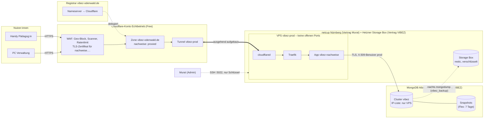

# Betriebsarchitektur – Echtbetrieb VIBEZ Nachweise

Stand: 15.11.2026 · gilt für den Echtbetrieb mit echten Klientendaten. Die Demo unter `vibez.bay-ram.de` läuft getrennt davon
auf dem Server von Murat und enthält nur erfundene Daten.

## Inhalt

- [Entscheidungen auf einen Blick](#entscheidungen-auf-einen-blick)
- [Gesamtbild](#gesamtbild)
- [Weg einer Anfrage](#weg-einer-anfrage)
- [Komponenten](#komponenten)
- [Netze und Erreichbarkeit](#netze-und-erreichbarkeit)
- [Domain und DNS](#domain-und-dns)
- [Daten, Backup und Wiederherstellung](#daten-backup-und-wiederherstellung)
- [Verwaltungszugang](#verwaltungszugang)
- [Überwachung](#überwachung)
- [Atlas-Einrichtung (wie DRK)](#atlas-einrichtung-wie-drk)
- [Kosten (Größenordnung)](#kosten-größenordnung)

## Entscheidungen auf einen Blick

| Thema | Entscheidung | Begründung |
|---|---|---|
| Server | Eigener VPS bei **netcup** (VPS Lite 1 G12.5s), Rechenzentrum **Nürnberg**, **Vertragspartner Murat** (Unterauftragsverarbeiter, Stand 18.11.2026) | Klare Trennung von anderen Systemen, deutscher Anbieter mit AV-Vertrag und ISO 27001; die Daten liegen in Atlas (Vertrag VIBEZ), der Server ist ersetzbar |
| Betrieb | Murat Bayram als IT-Dienstleister (Auftragsverarbeiter, Verschwiegenheit nach § 203 StGB) | Betreuung wie bisher, aber auf VIBEZ-eigener Infrastruktur |
| Adresse | `nachweise.vibez-odenwald.de` | **Eigene Domain nur für die App**, DNS komplett bei Cloudflare (Entscheidung 18.11.2026). Website und E-Mail von VIBEZ (`vibez-jugendhilfe.de`, All-Inkl) bleiben unberührt |
| Schutz vor dem Server | **Cloudflare** (Free) als Proxy mit WAF, nur für `nachweise` | Geo-Block, Schutz vor Angriffen und Scannern, Server ohne offene Ports |
| Anbindung Server | **Cloudflare Tunnel** (`cloudflared`) | Keine eingehenden Ports, Server-IP bleibt verborgen |
| Reverse Proxy | **Traefik** v3 | Routing, Ratenbremse je echter IP, HSTS, Zugriffsprotokoll |
| Datenbank | **MongoDB Atlas**, Region **AWS Frankfurt (eu-central-1)**, Projekt nur für VIBEZ | Wie bei der DRK-Klientendokumentation: verschlüsselt gespeichert, repliziert, verwaltete Backups; Zugriff nur von der IP des VPS (per Atlas-API gepflegt) |
| Backup | Nächtliche Sicherung mit **restic** (verschlüsselt) auf einer **Hetzner Storage Box**; dazu Atlas-Snapshots (Flex: täglich, 7 Tage) | Anderer Anbieter, anderer Standort; monatlicher Wiederherstellungstest |
| Verwaltung | SSH nur per Schlüssel auf Port **5022**, Ratenbegrenzung; kein VPN (Entscheidung 18.11.2026) | einfach; Schutz durch Schlüssel-Login, kein Passwort, kein root |
| Versionen | App-Image mit fester Versionsnummer (`VERSION` im App-Repo) und Digest; **automatisches Ausrollen** durch den Server (`host/autodeploy.sh`, Timer alle 5 Min.): Produktion nur bei neuer Versionsnummer, Testing (`nachweise-testing`, eigener Stack und eigene Datenbank) bei neuem Digest von `:testing` (Entscheidung Murat, 18.11.2026) | Nachvollziehbar, Rückweg automatisch bei fehlgeschlagenem Health-Check; GitHub hat keinen Zugang zum Server |

## Gesamtbild

## Weg einer Anfrage

1. Das Handy fragt `nachweise.vibez-odenwald.de` an. Die Nameserver von Cloudflare antworten mit einer
   Cloudflare-Adresse (proxied Eintrag).
2. Cloudflare beendet TLS mit einem eigenen Zertifikat für `nachweise.vibez-odenwald.de` und prüft die Anfrage (WAF,
   Geo-Block EU/CH, Ratenlimit, Managed Rules).
3. Cloudflare schickt die Anfrage durch den **Tunnel** zu `cloudflared` auf dem Server. Diese Verbindung hat `cloudflared`
   von innen aufgebaut; am Server ist kein Port offen.
4. `cloudflared` gibt die Anfrage an **Traefik** weiter (internes Netz). Traefik prüft den Hostnamen, begrenzt die Rate je
   echter IP (`Cf-Connecting-Ip`), setzt HSTS und protokolliert Metadaten.
5. Traefik leitet an die **App** weiter. Sie prüft Anmeldung, Rolle und CSRF und setzt eigene Sicherheits-Header (CSP u. a.).
6. Die App liest und schreibt in **MongoDB Atlas** (Frankfurt), verschlüsselt per TLS. Atlas nimmt Verbindungen nur von
   der festen IPv4 des VPS an (IP-Zugriffsliste) und nur mit dem X.509-Benutzer `prod`, der ausschließlich die Datenbank
   `vibez` lesen und schreiben darf.

## Komponenten

| Container | Image (fest) | Netz | Aufgabe | Härtung |
|---|---|---|---|---|
| `vibez-cloudflared` | `cloudflare/cloudflared:2026.10.7` | edge | Tunnel zu Cloudflare | read-only, no-new-privileges, 128 MB |
| `vibez-traefik` | `traefik:v3.7.17` | edge, web | Reverse Proxy | read-only, kein Dashboard, keine Docker-Socket-Anbindung (nur Datei-Konfiguration) |
| `vibez-app` | `ghcr.io/mbay-odw/vibez-nachweise:<VERSION>` | web, atlas | Anwendung | read-only, unprivilegierter Benutzer, ausgehend nur zu Atlas nötig |
| (Atlas) | MongoDB, Tarif Flex | – | Datenbank | TLS, IP-Zugriffsliste, getrennte Benutzer (App: `readWrite` auf `vibez`; Backup: `read` auf `vibez`), Verschlüsselung ruhender Daten |

Konfiguration: [`stacks/`](../stacks/) (ein Portainer-Stack je Dienst, siehe
[Betriebshandbuch](betriebshandbuch.md#stacks-und-portainer)), [`config/traefik/`](../config/traefik/),
[`config/cloudflared/config.yml`](../config/cloudflared/config.yml). Geheimnisse stehen ausschließlich unter
`/srv/vibez/secrets/` auf dem Server (nicht im Repo, nicht in Portainer).

## Netze und Erreichbarkeit

| Von → nach | Erlaubt | Wie erzwungen |
|---|---|---|
| Internet → Server | nur SSH auf 5022 (Schlüssel) | `ufw deny incoming`, keine veröffentlichten Docker-Ports |
| Cloudflare → App | nur über den Tunnel | `cloudflared` baut ausgehend auf |
| cloudflared → Traefik | HTTP im Netz `edge` | Traefik vertraut `X-Forwarded-*` nur aus `172.30.0.0/24` |
| Traefik → App | HTTP im Netz `web` (intern) | Docker-Netz `internal: true` |
| App → MongoDB Atlas | TLS über das Netz `atlas` | Atlas-IP-Zugriffsliste (VPS-IPv4); Anmeldung per X.509-Zertifikat |
| Traefik → Internet | **nichts** | Traefik hängt nur an `edge` (für cloudflared) und `web` (intern) |
| Admin → Server | SSH auf Port 5022, nur Schlüssel | `ufw limit 5022/tcp`, `PasswordAuthentication no`, `PermitRootLogin no` |
| Server → Internet | ausgehend (Updates, Tunnel, Backup, Image-Download) | – |

## Domain und DNS

Die App hat eine **eigene Domain `vibez-odenwald.de`** (Entscheidung 18.11.2026). Ihre DNS liegt komplett bei Cloudflare.
Die Domain von VIBEZ (`vibez-jugendhilfe.de`) mit Website (Webflow) und E-Mail (Microsoft 365) bleibt bei All-Inkl und
wird nicht verändert. Ein Fehler in der App-Zone kann damit weder Website noch E-Mail von VIBEZ treffen.

| Wo | Eintrag | Zweck |
|---|---|---|
| Registrar | Nameserver von `vibez-odenwald.de` → die zwei Cloudflare-Nameserver, DS-Eintrag (DNSSEC) | Cloudflare beantwortet die DNS |
| Cloudflare, Zone `vibez-odenwald.de` | `nachweise` CNAME → `<TUNNEL-ID>.cfargotunnel.com`, **proxied** (legt `cloudflared tunnel route dns` an) | App über Tunnel, WAF und TLS |
| Cloudflare | Null-MX, SPF `-all`, DMARC `p=reject`, CAA | Kein Mailversand unter der Domain möglich, nur erlaubte Zertifizierungsstellen |

Fakten (geprüft 15./16.11.2026):

- Universal SSL stellt das Zertifikat für `nachweise.vibez-odenwald.de` automatisch aus (Free).
- WAF-Regeln, Ratenlimit und Zoneneinstellungen wirken nur auf proxied Einträge, also nur auf die App.
- **Regional Services** (TLS-Terminierung nur in EU-Rechenzentren) sind ein Enterprise-Zusatz. Im Free-Tarif kann die
  Entschlüsselung in jedem Cloudflare-Rechenzentrum stattfinden (in der Praxis das nächstgelegene, für Hessen meist
  Frankfurt). Bewertet in der [Datenschutz-Folgenabschätzung](../datenschutz/dsfa.md).
- Den Mitarbeitenden die neue Adresse bekannt machen (z. B. Link auf der Website oder im Intranet von VIBEZ), damit sie
  echte Anmeldeseiten von nachgemachten unterscheiden können.

## Daten, Backup und Wiederherstellung

| Was | Wo | Schutz |
|---|---|---|
| Datenbank | MongoDB Atlas, AWS Frankfurt (eu-central-1) | TLS, IP-Zugriffsliste, Benutzer je Zweck, Verschlüsselung ruhender Daten durch Atlas |
| Backup 1 | Atlas Backup (Flex): tägliche Snapshots, 7 Tage (laut Atlas-Oberfläche, Murat 18.11.2026), kein Point-in-Time | in Atlas, Region Frankfurt |
| Backup 2 | Hetzner Storage Box (DE) | `mongodump` mit Lese-Benutzer → **restic-Verschlüsselung (AES-256) auf dem VPS**; Hetzner sieht nur verschlüsselte Blöcke |
| restic-Passwort | `.env` auf dem Server **und** offline im Passwortmanager von VIBEZ | ohne Passwort keine Wiederherstellung – beide Kopien sind Pflicht |
| Zugriffsprotokoll Traefik | `/srv/vibez/logs/traefik` | 14 Tage, nur Metadaten (IP, Land, Pfad, Status) |
| Änderungsprotokoll der App | in der Datenbank (`audit`) | Teil beider Backups |

Ablauf Backup 2: `vibez-backup.timer` jede Nacht um 02:30 Uhr → `mongodump` aus Atlas mit dem Backup-Benutzer →
`restic backup` → `restic forget` (7 tägliche, 5 wöchentliche, 12 monatliche Stände) → Meldung an Uptime Kuma. Sonntags
werden 10 % der Daten gegengelesen. Am 1. jedes Monats spielt `vibez-restoretest.timer` den neuesten Stand in eine
**Wegwerf-MongoDB ohne Netz** auf dem VPS ein, zählt Nachweise und Rechnungen und löscht sie wieder.

Wiederherstellungsziele: **RPO** ≤ 24 Stunden (bei Atlas mit Point-in-Time deutlich weniger), **RTO** ≤ 1 Arbeitstag
(neuer Server nach [Deployment](deployment.md), Datenbank bleibt in Atlas).

## Verwaltungszugang

- Nur Murat (Admin) hat SSH-Zugang: persönliches Konto, nur Schlüssel, Port 5022, `ufw limit`. Der private Schlüssel liegt nur auf Murats Admin-Geräten (mit Passphrase oder Hardwareschlüssel).
- Notzugang über die netcup-Konsole (SCP) mit dem Passwort des Admin-Kontos. Das Passwort liegt im Passwortmanager von VIBEZ.
- Der netcup-Vertrag läuft auf Murat, die Storage Box auf VIBEZ. 2FA ist Pflicht, kein geteiltes Login. Der Notzugang zur netcup-Konsole muss VIBEZ auch ohne Murat möglich sein (Zugangsdaten versiegelt bzw. im Passwortmanager von VIBEZ).
- **Aufbauphase:** Nur solange keine echten Daten vorhanden sind, richtet eine KI-Sitzung den Server über Remote Control ein.
  Danach wird dieser Zugang vollständig entfernt ([aufbau.md](aufbau.md)).
- **Verwaltungsoberflächen wie bei DRK (Entscheidung Murat, 18.11.2026): LLDAP (Benutzer und Gruppen), Authelia (Anmeldung mit 2FA), Portainer, Dozzle und Uptime Kuma auf dem Server, nur über den Tunnel unter `auth.`, `ldap.`, `portainer.`, `logs.` und `status.vibez-odenwald.de`; Zugang nur für die LDAP-Gruppe `vibez-infra_admin` mit zweitem Faktor** (Stacks `traefik`, `ldap`, `portainer`, `dozzle`, `uptime`, Regeln in
  [`config/authelia/configuration.yml`](../config/authelia/configuration.yml)). Die App-Konten folgen mit der
  LDAP-Anbindung der App (Gruppen `vibez-app_admin`/`vibez-app_user`, Testing `vibez-testing_*`).
- **Keine KI-/Automations-Zugänge zum Echtbetrieb:** Portainer und die anderen Oberflächen werden **nicht** an MCP-Server
  oder andere Werkzeuge angebunden, über die KI-Assistenten Befehle ausführen oder Daten lesen könnten. Entwicklung und Tests laufen
  ausschließlich mit der Demo und erfundenen Daten.
- Jede Wartung mit Datenbankzugriff wird im Wartungsprotokoll vermerkt ([Betriebshandbuch](betriebshandbuch.md#wartungsprotokoll)).

## Überwachung

| Prüfung | Werkzeug | Meldung |
|---|---|---|
| `https://nachweise.vibez-odenwald.de/health` alle 60 s (HTTP-Monitor) | Uptime Kuma (bestehend, bei Murat) | ntfy an Murat |
| Backup-Heartbeat (Push-Monitor, 26 h) | Uptime Kuma | ntfy an Murat |
| Zertifikat `nachweise` | Cloudflare (automatische Verlängerung) + Uptime-Kuma-Zertifikatsprüfung | ntfy |
| Sicherheitsupdates Betriebssystem | `unattended-upgrades` mit Neustart 04:15 Uhr bei Bedarf | – |
| Container-Updates | monatlich manuell (Betriebshandbuch) | – |

Uptime Kuma sieht nur die öffentliche Health-Adresse (Antwort `{"ok": true}`), keine Inhalte.

## Atlas-Einrichtung (wie DRK)

| Einstellung | Wert |
|---|---|
| Organisation / Projekt | eigenes Projekt „VIBEZ Nachweise“; Organisation von VIBEZ (Murat als Projektmitglied mit 2FA) |
| Region | AWS **eu-central-1 (Frankfurt)** |
| Tarif | **Flex** (Entscheidung Murat, 18.11.2026; M10 für den Anfang zu teuer). Gemeinsam genutzte Hardware, begrenzter Speicher und Durchsatz (Grenzen laut aktuellem Atlas-Preisblatt), Backup: tägliche Snapshots, 7 Tage (laut Atlas-Oberfläche, Murat 18.11.2026), kein Point-in-Time. Wechsel auf M10, wenn Speicher (Alarm bei 70 %) oder Last es verlangen |
| Netzwerkzugang | IP-Zugriffsliste **nur** die öffentliche IPv4 des VPS, gepflegt mit [`host/atlas-zugriffsliste.sh`](../host/atlas-zugriffsliste.sh) (Atlas Admin API); kein `0.0.0.0/0` |
| Datenbank-Benutzer | `prod` (App, readWrite + dbAdmin auf `vibez`; dbAdmin für die Indizes beim Start), `vibez_backup` (nur *read* auf `vibez`, reicht für `mongodump` einer Datenbank); Admin-Rechte nur befristet für Wartung. Anmeldung per **X.509-Zertifikat** von Atlas (Entscheidung Murat, 18.11.2026), 24 Monate gültig, auf dem Server erzeugt |
| Backup | Flex: tägliche Snapshots, 7 Tage. Für längere Aufbewahrung und Unabhängigkeit vom Anbieter ist die restic-Sicherung (Backup 2) Pflicht und muss vor dem Echtbetrieb samt Restore-Test laufen. Ab Flex/M10: Cloud Backup erweitern, 7 Tage täglich + 4 Wochen + 12 Monate |
| Benachrichtigungen | Atlas-Alerts (Verbindungen, Speicher ab 70 %) an Murat; Backup-Fehler meldet `host/backup.sh` |
| AV-Vertrag | MongoDB-DPA (Bestandteil der Atlas-Bedingungen) für VIBEZ dokumentieren, Region und Unterauftragnehmer (AWS) festhalten |

Alternative ohne Atlas: MongoDB als Container auf dem VPS (internes Netz, `--auth`). Dann entfallen MongoDB Inc. und AWS
als Auftragsverarbeiter; dafür liegen Verschlüsselung ruhender Daten und Backup vollständig in eigener Verantwortung.

## Kosten (Größenordnung)

| Posten | Größenordnung | Bemerkung |
|---|---|---|
| netcup VPS Lite 1 G12.5s (2 vCore, 4 GB, 80 GB, Nürnberg) | 5,86 € / Monat inkl. MwSt. (Angebot 16.11.2026) | 6 Monate Mindestlaufzeit |
| MongoDB Atlas (Flex, Frankfurt) | nutzungsabhängig, mit Obergrenze je Monat (Betrag laut Atlas-Preisblatt bzw. erster Rechnung eintragen) | M10 deutlich teurer; Wechsel nur bei Bedarf |
| Hetzner Storage Box (kleinste Größe) | wenige € / Monat | zweite Sicherung |
| Cloudflare Free | 0 € | |
