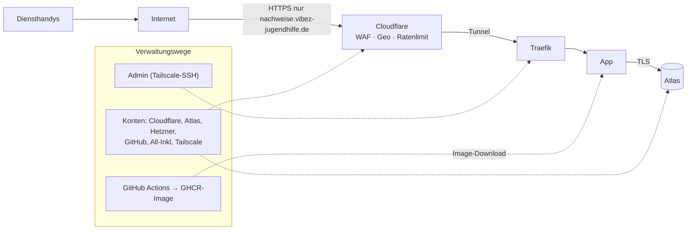

# Sicherheitsanalyse – Angriffsvektoren und Befunde

Stand: 15.11.2026 · geprüft: App `vibez-nachweise` 0.2.4 (Code, Abhängigkeiten, Browserverhalten), Demo-Betrieb auf
`vibez.bay-ram.de`, geplanter Echtbetrieb nach diesem Repository. Die Befunde mit „behoben“ sind in App-Version **0.2.5**
umgesetzt und getestet.

## Inhalt

- [Schutzobjekte und Angreifer](#schutzobjekte-und-angreifer)
- [Angriffsfläche](#angriffsfläche)
- [Befunde und Maßnahmen](#befunde-und-maßnahmen)
  - [A. Anwendung](#a-anwendung)
  - [B. Lieferkette (Code, Abhängigkeiten, Images)](#b-lieferkette-code-abhängigkeiten-images)
  - [C. Echtbetrieb (Infrastruktur)](#c-echtbetrieb-infrastruktur)
  - [D. Konten und Identitäten](#d-konten-und-identitäten)
  - [E. Demo-Betrieb](#e-demo-betrieb)
  - [F. Menschen und Organisation](#f-menschen-und-organisation)
- [Was bewusst so bleibt](#was-bewusst-so-bleibt)
- [Nächste Schritte nach Priorität](#nächste-schritte-nach-priorität)

## Schutzobjekte und Angreifer

| Schutzobjekt | Warum wertvoll |
|---|---|
| Klientendaten (Namen, Hilfeart, Termintexte, Unterschriften) | Sozialdaten von Kindern, teils mit Gesundheitsbezug – Offenlegung kann Familien schaden |
| Abrechnungsdaten | Manipulation führt zu falschen Rechnungen gegenüber Jugendämtern (Betrugsvorwurf) |
| Verfügbarkeit | ohne Nachweise keine Abrechnung |
| Zugänge (App, Cloudflare, Atlas, Hetzner, GitHub, Domain) | Schlüssel zu allem Obigen |

| Angreifer | Fähigkeit / Motiv |
|---|---|
| Opportunistische Angreifer aus dem Internet | Scanner, Passwort-Durchprobieren, bekannte Lücken; wollen Daten oder Ressourcen |
| Gezielter Angreifer | Phishing gegen Verwaltung oder IT, Übernahme von Konten (Cloudflare, Atlas, GitHub, All-Inkl) |
| Innentäter mit App-Zugang | neugierige oder böswillige Beschäftigte; Fälschen von Nachweisen/Unterschriften |
| Privilegierte Dienstleister | IT-Betreuung, Hosting-/Cloud-Personal |
| Staatliche Stellen in Drittländern | rechtlicher Zugriff auf US-Anbieter (Cloudflare, MongoDB) – siehe DSFA R5/R6 |
| Diebe/Finder von Diensthandys | Zugriff auf offene Sitzung |

## Angriffsfläche

Öffentlich erreichbar sind nur die Login-Seite, die Hilfe, `/health` und die statischen Dateien. Alle anderen Seiten
verlangen eine Anmeldung. Der Server hat keine offenen Ports, die Datenbank nimmt nur Verbindungen von der Server-IP an.
Die größten Hebel für Angreifer liegen deshalb bei den **Konten** (D) und der **Lieferkette** (B), nicht beim Server
selbst.

## Befunde und Maßnahmen

Schwere: 🔴 hoch · 🟠 mittel · 🟡 niedrig. Status: ✅ behoben (0.2.5) · 📄 im Betriebsdesign umgesetzt · ⏳ offen.

### A. Anwendung

| # | Vektor | Befund | Schwere | Status |
|---|---|---|---|---|
| A1 | Bekannte Lücken in Abhängigkeiten | `pip-audit`: über 200 bekannte Lücken in Pillow 11.1, Starlette 0.41, python-multipart 0.0.20, pypdf 5.1, pymongo, jinja2. Relevant waren u. a. **DoS ohne Anmeldung** (Range-Header bei statischen Dateien, Formular-Parser) und **Speicherfehler in Bild-Decodern** | 🔴 | ✅ alle aktualisiert, `pip-audit` meldet nichts mehr; Prüfung in der CI, Dependabot |
| A2 | Unterschrift als Einfallstor für Bild-Decoder | Die App nahm jede Base64-Datei an und ließ Pillow das Format raten (PSD, FITS, GD …, teils mit Speicherfehlern bis zur Codeausführung). Jede angemeldete Person hätte so eine präparierte Datei schicken können. | 🔴 | ✅ nur PNG (`formats=["PNG"]`), max. 4000×2000 px |
| A3 | Passwort-Durchprobieren | Die Anmeldebremse zählte je *Benutzer + IP aus `X-Forwarded-For`*. Den Header kann der Client selbst setzen, also ließ sich die Bremse durch einen wechselnden Header beliebig umgehen. Zudem nannte die öffentliche Hilfe den Benutzernamen der Verwaltung. | 🔴 | ✅ Zählung je Konto (10/10 Min.) und je echter IP aus `Cf-Connecting-Ip` (30/10 Min.); Fehlversuche protokolliert; Hilfe ohne echte Namen. Dazu Cloudflare-Ratenlimit (5/10 s) |
| A4 | Offene Weiterleitung | `next=/\evil.example` nach dem Login führte auf eine fremde Seite (Browser behandeln `/\` wie `//`). Damit wäre Phishing mit echter VIBEZ-Adresse im Link möglich gewesen. | 🟠 | ✅ nur noch relative Pfade |
| A5 | Gestohlene Sitzung bleibt gültig | Die Sitzung liegt signiert im Cookie. „Abmelden“ oder ein neues Passwort beendeten Sitzungen auf anderen Geräten nicht, sie liefen bis zu 12 Stunden weiter. | 🟠 | ✅ Sitzungsversion je Konto: Passwortwechsel, Reset, Deaktivieren und Rollenwechsel beenden alle Sitzungen; „auf allen Geräten abmelden“; Abmeldung nach 2 Stunden Inaktivität |
| A6 | Schwache Passwörter | Mindestlänge 8, keine weitere Prüfung | 🟠 | ✅ 12 Zeichen, Sperrliste, nicht der eigene Name |
| A7 | Zweiter Faktor fehlt | Ein gephishtes Passwort genügt für den Zugang | 🟠 | ⏳ TOTP, Pflicht für die Verwaltung (DSFA M1) |
| A8 | Zu breite Einsicht | Jede Pädagog:in kann über die Vertretung **alle** Klient:innen sehen (fachlich gewollt). IDs sind ObjectIds und teilweise vorhersagbar, das spielt aber keine Rolle, weil der Zugriff ohnehin erlaubt ist. | 🟠 | ✅ Zugriffe auf fremde Klient:innen werden protokolliert (einmal je Sitzung und Ansicht), ebenso das Öffnen fremder Listen. ⏳ Prüfung der Protokolle durch die Verwaltung (organisatorisch) |
| A9 | Gefälschte Unterschrift der Klient:in | Unterschriftsbilder sind für Berechtigte sichtbar. Eine Pädagog:in könnte ein vorhandenes Bild kopieren und für einen weiteren Termin absenden. | 🟠 | ✅ identische Unterschriftsbilder werden je Klient:in abgelehnt und protokolliert. Rest: Ein *abgemaltes* Bild ist technisch nicht erkennbar; das gilt auch auf Papier |
| A10 | Manipulation von Bewilligungen | Über das Bewilligungsformular einer Klient:in ließ sich mit einer fremden Bewilligungs-ID eine Bewilligung einer anderen Klient:in überschreiben und umhängen. | 🟠 | ✅ ID muss zur Klient:in gehören |
| A11 | Formel-Injektion in CSV | Ein Klientenname wie `=HYPERLINK(…)` wird beim Öffnen der Rechnungsliste in Excel als Formel ausgeführt. Eine Pädagog:in kann Klient:innen anlegen. | 🟠 | ✅ Zellen mit `= + - @` werden entschärft |
| A12 | Große Anfragen / Ressourcen | keine Größenbegrenzung in der App (nur Traefik im Echtbetrieb) | 🟡 | ✅ 2 MB, kein chunked POST |
| A13 | Host-Header | `request.url` und der „Zurück“-Link stützen sich auf den Host-Header | 🟡 | ✅ optional nur bekannte Hosts (`VN_HOSTS`), im Echtbetrieb gesetzt |
| A14 | XSS / CSRF / Injection | Jinja maskiert automatisch, kein `|safe`, kein `innerHTML`; CSRF-Token in allen Formularen; PyMongo ohne String-Abfragen; CSP ohne Inline-Skripte; keine Uploads außer Unterschriften | – | geprüft, ohne Befund |
| A15 | Datenabfluss an Dritte | Bis 0.2.3 wurde die Schrift von Google Fonts geladen, dabei ging bei jedem Seitenaufruf die IP an Google. | 🟡 | ✅ seit 0.2.4 lokal |
| A16 | Abmelden per GET | `/logout` lässt sich von einer fremden Seite auslösen (Nutzer:in wird nur abgemeldet) | 🟡 | ⏳ auf POST umstellen (gering) |
| A17 | Nutzername erkennbar über Antwortzeit | Passwortprüfung nur bei existierendem Konto | 🟡 | ⏳ optional Schein-Prüfung; durch Bremse entschärft |
| A18 | Verwaltung kann jede Person „sein“ | Die Verwaltung kann Passwörter neu setzen und Unterschriften hinterlegen und damit im Namen anderer handeln | 🟡 | ✅ Reset, Rollen- und Unterschriftsänderungen werden jetzt einzeln protokolliert; organisatorisch: Vier-Augen-Prinzip für Verwaltungszugänge |

### B. Lieferkette (Code, Abhängigkeiten, Images)

| # | Vektor | Befund | Schwere | Status |
|---|---|---|---|---|
| B1 | Überschreibbare Versionsnummer | Die CI hat bei jedem Push das Image `0.2.4` neu gesetzt, sogar bei reinen Doku-Commits. „Feste Version“ war damit nicht fest. | 🔴 | ✅ eine veröffentlichte Version wird nie überschrieben; 📄 Echtbetrieb setzt **Version + Digest** ein (`0.2.5@sha256:…`), `deploy.sh` prüft das Format |
| B2 | Übernahme des GitHub-Kontos | Wer `mbay-ODW` übernimmt, kann ein präpariertes Image veröffentlichen | 🔴 | ⏳ 2FA mit Passkey/Hardwareschlüssel, Branch-Schutz auf `main` (nur über PR mit grüner CI), Digest-Pinning im Echtbetrieb (B1) |
| B3 | GitHub Actions nur über Tags eingebunden | `actions/checkout@v4` u. a. könnten bei Kompromittierung des Action-Repos umgebogen werden | 🟡 | ⏳ auf Commit-SHA pinnen (Dependabot hält sie aktuell) |
| B4 | Basis-Image `python:3.12-slim` ohne Digest | Builds sind nicht reproduzierbar | 🟡 | bewusst: bekommt so Sicherheitsupdates; Dependabot (docker) meldet neue Versionen |
| B5 | KI-gestützte Entwicklung | Code entsteht mit KI-Unterstützung | 🟡 | ✅ nur mit erfundenen Daten; kein Zugriff auf den Echtbetrieb; Tests und `pip-audit` in der CI; ⏳ Review vor Release durch einen Menschen |

### C. Echtbetrieb (Infrastruktur)

| # | Vektor | Befund | Schwere | Status |
|---|---|---|---|---|
| C1 | Direkter Angriff auf den Server | Keine offenen Ports (Tunnel), Hetzner-Firewall und `ufw` ohne Eingang, SSH nur über Tailscale | – | 📄 |
| C2 | Umgehen von Cloudflare | Ohne öffentliche Ports gibt es keinen Weg vorbei | – | 📄 |
| C3 | Diebstahl der Tunnel-Zugangsdaten | Mit `credentials.json` kann jemand einen **zweiten Connector** betreiben und einen Teil des Datenverkehrs empfangen (Mitlesen) | 🟠 | 📄 Datei nur root (600); ⏳ Cloudflare-Benachrichtigung bei Tunnel-Änderungen/zusätzlichen Connectoren; bei Verdacht Tunnel neu erzeugen (Betriebshandbuch) |
| C4 | Backups löschen oder verschlüsseln (Ransomware) | Wer root auf dem Server hat, kann über SFTP auch die restic-Daten auf der Storage Box löschen | 🟠 | 📄 Atlas-Backups lassen sich mit den Datenbankbenutzern des Servers nicht löschen; ⏳ **automatische Snapshots der Storage Box** einschalten (nur in der Hetzner-Konsole verwaltbar) |
| C5 | Tailscale als Seiteneingang | Jedes Gerät in Murats Tailnet erreicht standardmäßig den Server (Schlüssel nötig, aber größere Angriffsfläche) | 🟠 | ⏳ Tailscale-ACL: nur Murats Admin-Geräte → `tag:vibez-prod:22`; Tailnet Lock erwägen |
| C6 | Übernahme der Hilfsdomain | Läuft `vibez-edge.de` aus und registriert sie jemand anders, zeigt `nachweise.vibez-jugendhilfe.de` (CNAME) auf dessen Server. Der Angreifer könnte dann ein gültiges Zertifikat beantragen und eine echt wirkende Login-Seite betreiben. | 🔴 | ⏳ Auto-Verlängerung + Registrar-Sperre, Ablauf im Monitoring; CNAME bei Abbau sofort entfernen |
| C7 | Manipulation der DNS bei All-Inkl | Wer das KAS-Konto übernimmt, kann `nachweise` umleiten (Phishing, Zertifikat per DNS) | 🔴 | ⏳ 2FA im All-Inkl-Konto; **CAA-Eintrag** (nur die von Cloudflare genutzten CAs); Überwachung der Zertifikatstransparenz-Logs für `vibez-jugendhilfe.de` (z. B. Cert Spotter, kostenlos) |
| C8 | Atlas über das Internet | Atlas lässt nur die Server-IP zu; Passwort-Authentifizierung + TLS | 🟡 | 📄; ⏳ in der Atlas-Organisation „IP-Zugriffsliste für die Admin-API verlangen“ aktivieren, API-Keys mit eigener Zugriffsliste |
| C9 | Geheimnisse auf dem Server | `.env` enthält Atlas-Passwort, Schlüssel und das restic-Passwort | 🟡 | 📄 Datei 600 root; Rechte der Atlas-Benutzer minimal; nach Kompromittierung alle rotieren (Betriebshandbuch) |
| C10 | Protokolle mit IP-Adressen | Traefik 14 Tage, Cloudflare je Tarif | 🟡 | 📄 |
| C11 | Container-Ausbruch | Container laufen read-only, ohne Zusatzrechte und ohne Docker-Socket. Die App läuft als unprivilegierter Benutzer. | – | 📄 |

### D. Konten und Identitäten

Das sind die wirksamsten Angriffswege. Wer eines dieser Konten übernimmt, umgeht alle Schutzschichten:

| Konto | Folge einer Übernahme | Pflicht |
|---|---|---|
| Cloudflare (VIBEZ) | Datenverkehr umleiten oder mitlesen, WAF abschalten | 2FA mit **Passkey/Hardwareschlüssel**, kein Global API Key |
| MongoDB Atlas | Daten lesen, Zugriffsliste öffnen, Backups löschen | 2FA, Benachrichtigung bei Änderungen der Zugriffsliste |
| Hetzner | Server-Konsole, Snapshots, Storage Box | 2FA, Murat als eigenes Mitglied |
| GitHub `mbay-ODW` | präpariertes Image (B2) | 2FA mit Passkey, Branch-Schutz |
| All-Inkl | DNS umleiten (C7) | 2FA |
| Tailscale (Murat) | Weg zum SSH-Port (Schlüssel weiterhin nötig) | 2FA, ACL (C5) |
| Verwaltungskonten der App | alle Klientendaten, Abrechnung | 2FA (A7), starke Passwörter (✅) |

### E. Demo-Betrieb

Die Demo enthält nur erfundene Daten. Trotzdem:

| # | Befund | Empfehlung |
|---|---|---|
| E1 | `VN_SECRET_KEY` und die Startpasswörter der Demo standen in Werkzeugaufrufen dieser Entwicklungssitzung (Portainer) und sind damit in Sitzungsprotokollen gespeichert. Mit dem Schlüssel ließen sich Demo-Sitzungen fälschen. | Demo-Schlüssel und -Passwörter neu setzen. **Geheimnisse des Echtbetriebs nie über KI-Sitzungen leiten.** |
| E2 | Die Demo läuft auf Murats Server im Netz `fe-untrusted` zusammen mit anderen Diensten. Die App hat Internetzugang, die Demo-Mongo ist ohne Passwort (nur im internen Stack-Netz). | Akzeptabel für erfundene Daten; **keine echten Daten in die Demo** |
| E3 | KI-Werkzeuge (Portainer-MCP) können in die Demo-Container hinein Befehle ausführen. | Für die Demo gewollt, für den Echtbetrieb ausgeschlossen (siehe Abnahme-Checkliste) |
| E4 | Die Demo nutzt `latest` | für die Demo in Ordnung |

### F. Menschen und Organisation

| # | Vektor | Maßnahme |
|---|---|---|
| F1 | Phishing auf Zugangsdaten (gefälschte Login-Seite) | 2FA (A7); Schulung: Adresse prüfen, Login nur über das Lesezeichen/den Home-Bildschirm |
| F2 | Verlorenes Handy | Bildschirmsperre, sofort melden → Verwaltung deaktiviert das Konto, alle Sitzungen enden sofort |
| F3 | Weitergabe von Passwörtern | Persönliche Konten, Protokoll zeigt, wer was getan hat |
| F4 | Zugangsdaten über Messenger | Startpasswörter persönlich oder per Telefon übergeben, Wechsel beim ersten Login (⏳ erzwingen) |
| F5 | Ausgedruckte Nachweise | Druckstapel wie bisher sicher verwahren und versenden (je Jugendamt getrennt) |

## Was bewusst so bleibt

- **Vertretung für alle Pädagog:innen**: fachlich gewollt; wird protokolliert (A8).
- **Cloudflare entschlüsselt den Verkehr**: Die WAF braucht den Klartext, um Angriffe zu erkennen. Abwägung in der DSFA (R5).
- **Unterschrift als Bild**: Das ist keine qualifizierte elektronische Signatur. Gefälschte Kopien werden erkannt, abgemalte nicht (A9).
- **Sitzung im Cookie**: Server-seitige Sitzungen wären etwas stärker. Durch Sitzungsversion und Inaktivitäts-Abmeldung ist das Risiko klein (A5).

## Nächste Schritte nach Priorität

1. ⏳ **Zwei-Faktor-Anmeldung** in der App (A7) – vor dem Echtbetrieb
2. ⏳ **2FA mit Passkeys** für Cloudflare, Atlas, Hetzner, GitHub und All-Inkl (D) und Branch-Schutz auf `main` (B2)
3. ⏳ **Hilfsdomain absichern**: Auto-Verlängerung, Sperre, CAA, Zertifikats-Monitoring (C6, C7)
4. ⏳ **Storage-Box-Snapshots** (C4) und **Tailscale-ACL** (C5)
5. ⏳ Demo-Geheimnisse neu setzen (E1)
6. ⏳ GitHub Actions per SHA pinnen (B3), `/logout` als POST (A16), Erstpasswort-Wechsel erzwingen (F4)
7. ➕ externer Penetrationstest nach dem Aufbau des Echtbetriebs, danach jährlich
